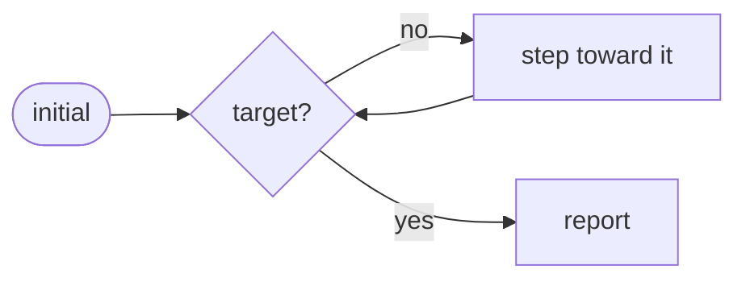

<div class="flex items-center gap-10" style="height: 100%">
<div class="title-hero" style="flex: 1 1 auto">

# Graph language for aiida-core v3

**Julian Geiger, Alexander Goscinski** · MSD GM · PSI — 19 November 2026

</div>
<div style="flex: 0 0 310px">
  
</div>
</div>

---

# Why: orchestration should read like the science

- Workflows spell orchestration as machinery: outline steps, submits, a `self.ctx` dict.
- Machinery fails where tests don't look: an unset `ctx` value crashes at runtime.
- Graphs keep the science and drop the machinery: plain Python, checked before it runs.

---

# Caught before submission

A missing binding fails when the graph is built — no profile, no daemon, no run.

```python
@graph
def broken(value: int, flag: bool) -> int:
    if flag:
        total = add(x=value, y=1)
    return total

broken.build()
```

The build error names the line:

```text
GraphLanguageError: bad.py:9:5: __main__:bad:
  without an `else` arm the branch keeps the prior
  binding, so `total` must be assigned before the
  `if`; assign it first or add an `else` arm instead
    if flag:
    ^
```

<div class="verdict" >

Invalid wiring fails during build(). Valid wiring still needs runtime tests.

</div>

---

# Same workflow, less machinery

Stepping toward a target: a `WorkChain` outline on the left, a graph on the right. Both compute the same thing.

::left::

**WorkChain: steps, submits, ctx**

```python
spec.outline(
    cls.init,
    while_(cls.has_steps_left)(
        cls.step, cls.update),
    cls.report)

def step(self):
    self.to_context(
        stepped=self.submit(
            StepToward,
            value=self.ctx.value,
            target=self.inputs.target))
```

::right::

**Graph: plain control flow**

```python
@graph
def converge(initial: int, target: int,
             max_steps: int) -> dict:
    value, attempts = initial, 0
    while value != target \
            and attempts < max_steps:
        value = step_toward(
            value=value, target=target)
        attempts = attempts + 1
    return report(value=value,
                  attempts=attempts)
```

::



---

# Where WorkChain concepts go

Each WorkChain concept has a graph counterpart. Nothing structural is decided at run time.

- `spec.input` / `spec.output` become function parameters and the return annotation, checked by `build()`.
- `spec.outline` steps become straight-line code; `if_` becomes `if`, `while_` becomes `while`.
- `submit` + `to_context` become a direct call; outputs arrive as named values.
- `self.ctx` resume state becomes carried loop state and inline values, checkpointed without stored nodes.
- `self.out(...)` becomes `return`: the graph returns existing nodes.
- `spec.exit_code` becomes `Result[..., Errors]` with `Err(...)`; declared outcomes branch and retry in the graph.

<div class="verdict" >

Existing CalcJobs and WorkChains slot in as tasks, unchanged.

</div>

---

# Control flow: orchestration and computation

One graph process schedules one selected task process.

**Ordinary Python — task body**

```python
@task
def add(x: int, y: int) -> int:
    return x + y
```

**Graph language — compiled orchestration**

```python
@graph
def choose(x: int, flag: bool) -> int:
    if flag:
        chosen = add(x=x, y=1)
    else:
        chosen = add(x=x, y=2)
    return chosen
```

A `GraphProcess` drives the graph, evaluates `flag`, and schedules the selected task. The task runs the Python body and creates the result node. Daemon execution may use different workers.

<div class="refs center">

Recorded provenance of a local run (`x=10, flag=True → result=11`): declared input names are preserved; `CREATE` and `RETURN` share one result node. Node identifiers are illustrative.

</div>


---

# Retry: handle a declared failure

Retry only the expected failure code, and stop when the retry budget is used.

```python
@graph
def restartable(x: int, max_retries: int,
                attempt: int = 0) -> int:
    value, error = run_step(x=x, attempt=attempt)
    while error is not None and attempt < max_retries:
        attempt = attempt + 1
        value, error = run_step(x=x, attempt=attempt)
    checked = ensure(value=value)
    return value
```

- `Result[int, StepErrors]` unpacks into `(value, error)`; `UNSTABLE` (410) plus remaining budget retries, `Ok(value)` finishes.
- The counter is inline state, not another child process. `ensure` fails the graph if all attempts failed.

---

# Parallel map, then sequential reduction

Expand each structure independently; average volumes after all complete.

```python
@graph
def mean_expanded_volume(
    structures: DataList,
) -> float:
    expanded = par_map(expand_cell, structures)
    return mean_cell_volume(structures=expanded)

@task
def mean_cell_volume(structures: DataList) -> float:
    if not structures:
        raise ValueError('empty structure list')
    total = 0.0
    for structure in structures:
        total += structure.get_cell_volume()
    return total / len(structures)
```

- `par_map` fans one unary task out over an owned `DataList`; a `for`-loop is supported inside `@task`, not inside `@graph`.
- All items dispatch before waiting; the result preserves order and the collector builds the container.

---

# PortModel: declare a structured interface

One schema defines nested ports, defaults and help text — for both tasks and graphs.

```python
from aiida.engine import PortModel

class Scaling(PortModel):
    factor: Annotated[float, PortField(help='Cell scale factor.')] = 1.05

class Settings(PortModel):
    scaling: Scaling
    label: str = 'demo'

@task
def scaled_volume(volume: float, settings: Settings) -> float:
    return volume * settings.scaling.factor ** 3
```

- Each field becomes its own input node; `settings={'scaling': {}}` fills the defaults (`11.57625` for volume `10.0`).

---

# Pydantic: reuse the schema, not its runtime

`BaseModel` declarations adapt to the same typed port namespaces as `PortModel`.

```python
from pydantic import BaseModel, Field

class PydanticScaling(BaseModel):
    factor: float = Field(default=1.05, description='Cell scale factor.')

class PydanticSettings(BaseModel):
    scaling: PydanticScaling
    label: str = 'demo'
```

- Nested models, defaults, and `Field(description=...)` help text work; leaves accept `str`, `int`, `float`, `bool` and their optional forms.
- Tasks receive attribute-accessible mappings, not model instances. Validators and aliases are rejected at declaration; check values inside the `@task`.

---

# Reuse existing CalcJobs and WorkChains

Wrap the process class with `task(...)`, then wire its named inputs and outputs.

```python
multiply_add = task(MultiplyAddWorkChain)
add_calc = task(ArithmeticAddCalculation)

@graph
def integrated(x: int, y: int, z: int) -> int | float:
    prepared = multiply_add(x=x, y=y, z=z)
    total = add_calc(x=prepared.result, y=z)
    return total.sum

outputs, node = run_get_node(
    integrated,
    inputs={'x': 2, 'y': 3, 'z': 4},
    runtime_config={
        'add_calc': {
            'code': code,
            'metadata': {'options': options},
        },
    },
)
```

- Execution settings travel separately from scientific inputs, under `runtime_config`.
- Both stay normal child processes with provenance.

---

# WorkChain: a missing context value

A spec can be valid while a context value is missing on one execution path.

```python
class ConditionalCtxChain(WorkChain):
    @classmethod
    def define(cls, spec):
        super().define(spec)
        spec.outline(
            if_(cls.should_add)(cls.add_one),
            cls.finish,
        )

    def should_add(self):
        return self.inputs.flag.value

    def add_one(self):
        self.ctx.total = increment(self.inputs.value)

    def finish(self):
        self.out('result', self.ctx.total)
```

- `flag = True`: `add_one → finish`, `result = value + 1`.
- `flag = False`: `add_one` skipped, `finish` raises `AttributeError: no attribute 'total'`. A test of only `flag=True` misses this bug.

---

# Same bug: rejected before build

Graph build checks both paths without running tasks or supplying inputs.

```python
@graph
def broken(value: int, flag: bool) -> int:
    if flag:
        total = add(x=value, y=1)
    return total

broken.build()
```

- `flag = False` leaves `total` with no binding: `GraphLanguageError: bind total before the if, or add an else arm`.
- WorkChain: the skipped path fails at runtime. Graph: invalid wiring fails during build.

<div class="verdict" >

Catch the missing binding before submission. This checks wiring, not task-body correctness; runtime tests are still needed.

</div>
